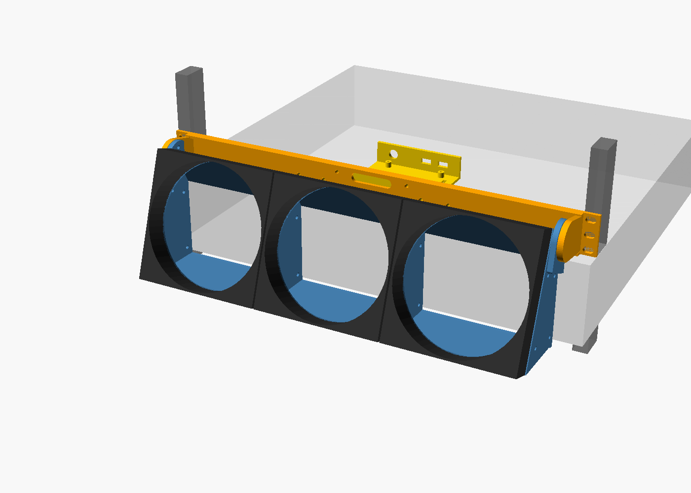
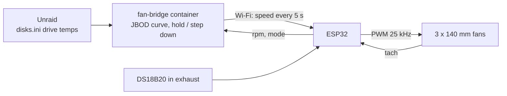
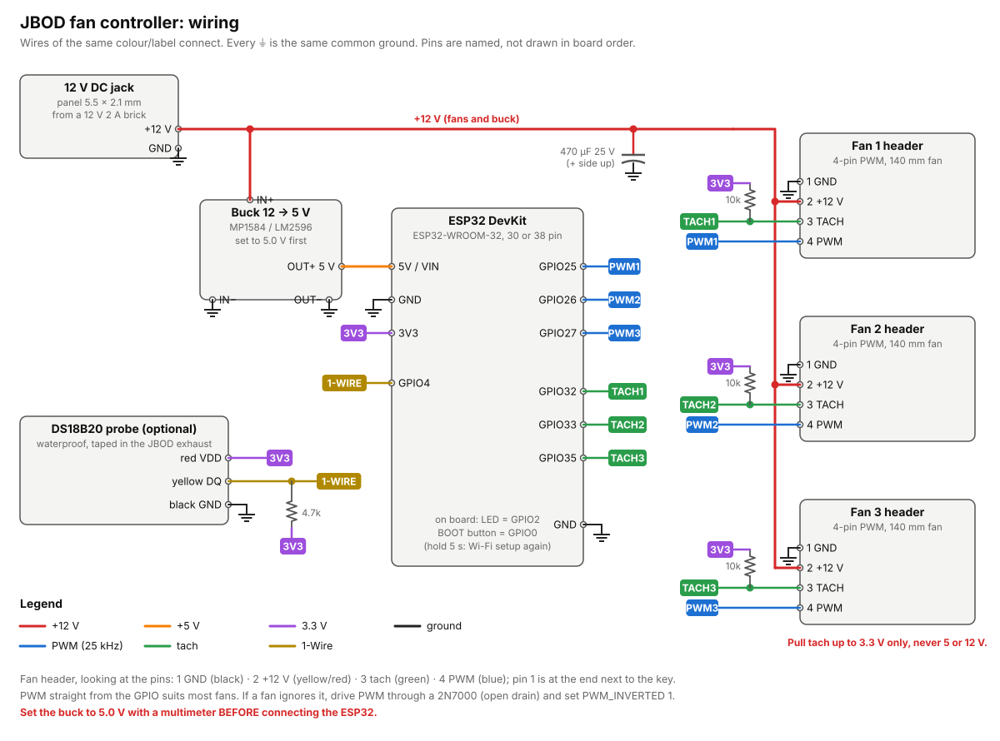

# JBOD fans: build guide

This replaces the HPE D3600's fixed-speed fans with three quiet 140 mm fans
that follow your drive temperatures. A 3D-printed 1U tray sits above the JBOD
and holds an ESP32. A hinged duct hangs from it and blows into the drive bays,
and lifts up when you need the drives. The fan-bridge container reads drive
temps from Unraid and tells the ESP32 how fast to run.





**If anything fails, the fans speed up, never down:**
- no word from the server for 20 s → failsafe 80 %, or the exhaust-probe curve
- a fan stalls → the other two go to 100 %
- power-up → 100 %, then failsafe until the server checks in

| | Where |
|---|---|
| Tick-box version of this guide, with blanks for your measurements | [CHECKLIST.md](../../hardware/jbod-hanger/CHECKLIST.md) |
| Parts list (spreadsheet) | [parts.csv](parts.csv) |
| Wiring diagram | [wiring.svg](wiring.svg) |
| Ready-to-flash firmware | [esp32/firmware/](../../esp32/firmware/) |
| Printable parts (STL) and model | [hardware/jbod-hanger/](../../hardware/jbod-hanger/) |

---

## 1. Before buying anything (30 min)

1. **Survey the Unraid host.** It only reads:
   ```bash
   bash tools/jbod_survey.sh 2>&1 | tee /tmp/jbod_survey.txt
   ```
   Every D3600 drive should show `expander=YES`, and the D3600 should be
   listed under *SES enclosures*. If `poll_attributes` isn't 60, set
   *Settings → Disk Settings → Tunable (poll_attributes)* to **60**.
2. **Look at the back of the D3600.** If the fans are built into the power
   supplies, stop here: they can't come out.
3. **Pull one fan module for 10 minutes.** A warning, or the other fan at full
   speed, is fine. Drives dropping out or the enclosure shutting off means
   don't remove the fans.
4. **Measure the rack** (CHECKLIST step 2). The key measurements:
   - how far the drive handles stick out past the posts
   - the drive-bay opening height
   - what sits in the U above
   - room to a front door: the duct sticks out **126 mm**

## 2. Parts

The full list with quantities and notes is in [parts.csv](parts.csv). In short:

| Group | Parts |
|---|---|
| Fans | 3 × 140 mm 4-pin PWM with high static pressure (Noctua NF-A14 industrialPPC-2000 PWM), 3 × finger guards, 3 × 30 cm PWM extension cables |
| Controller | ESP32-WROOM-32 DevKit, MP1584/LM2596 buck, 12 V 2 A brick, panel DC jack 5.5×2.1, 7×9 cm perfboard, 3 × 4-pin fan headers, 3 × 10k, 1 × 4.7k, 470 µF 25 V, DS18B20 waterproof probe |
| Hardware | M4×35 ×12, M4×12 ×16 + washers, M6×25 + nyloc ×2, M4×20 + wing nut ×2, M3×6 ×4, rack screws ×6, 1.5 m of 10×5 mm foam strip |
| Print | ~650 g PETG or ASA (not PLA) |
| Tools | multimeter, soldering iron, 4.3 / 6.5 mm drill bits |

## 3. Print

All STLs are in `hardware/jbod-hanger/stl/`, already oriented for printing:
- 0.2 mm layers, 4 walls, 30 % gyroid, no supports
- every part fits a 180 × 180 mm bed

1. **`fit_gauge`** (about 1 h). Hold it beside a rack post at the D3600:
   - flat back edge on the post face
   - the three notches on the three holes of the U above the D3600

   The rim line should sit 3–6 mm in front of the drive handles, and the
   rim notches should line up with the top and bottom of the bays. If not,
   change the measurement (step 1.4) in `jbod_hanger.scad`, run `./export.sh`,
   and reprint the gauge.
2. **`pin_test`.** An M6 bolt should turn freely, and an M4 pin should slide
   through both lock holes.
3. **The rest:**

   | Part | Qty | Lay it on the bed |
   |---|---|---|
   | `duct_left`, `duct_center`, `duct_right` | 1 each | rim face down |
   | `tray_left`, `tray_right` | 1 each | back face down |
   | `tray_center` | 1 | back face down |
   | `shelf` | 1 | floor down |
   | `splice` | 2 | flat |

## 4. Build the controller



| ESP32 pin | Goes to |
|---|---|
| 5V / VIN | buck OUT+ (5.0 V) |
| GND | common ground (buck OUT−, jack −, fan pin 1, probe black) |
| GPIO25 / 26 / 27 | fan 1 / 2 / 3, pin 4 (PWM) |
| GPIO32 / 33 / 35 | fan 1 / 2 / 3, pin 3 (tach), **each with 10k to 3V3** |
| GPIO4 | DS18B20 yellow (data), with 4.7k to 3V3 |
| 3V3 | pull-ups, DS18B20 red |
| — | +12 V from the jack goes to buck IN+ and every fan's pin 2 |

Solder in this order, checking as you go:

1. **Set the buck first.** With 12 V on its input and nothing on its output,
   turn the trimmer until the output reads **5.0 V**. Buck modules often ship
   set to 12 V or more, which would kill the ESP32.
2. **Power rails.** Mount the DC jack in the shelf's rear lip. On the board,
   wire the jack to the buck, the +12 V rail to the three fan headers, and the
   470 µF capacitor across 12 V and GND (stripe = −). Check with the
   multimeter: 12 V on every header's pin 2, and no short between 12 V and GND.
3. **ESP32 sockets** (female headers). Wire 5 V and GND to them. Plug in the
   ESP32, power up, and check that 3V3 reads 3.3 V. Unplug.
4. **Signals.** Wire the three PWM lines, then the three tach lines, each with
   its 10k up to **3.3 V**. Never pull tach up to 5 V or 12 V.
5. **Probe.** Add the 4.7k between GPIO4 and 3V3, and a 3-pin connector for the probe.
6. Screw the board onto the shelf posts with M3×6.

## 5. Flash the ESP32

The same firmware file suits everyone: Wi-Fi details are entered on a
setup page afterwards, not compiled in.

**Easiest, from a browser (Chrome or Edge, nothing to install):**
1. Plug the ESP32 into your computer with a USB data cable.
2. Open **https://espressif.github.io/esptool-js/** and click **Connect**. Pick
   the serial port; hold the BOOT button if it won't connect.
3. Click **Erase Flash**, and wait for it to finish.
4. Under *Program*, set the flash address to **0x0**, choose
   `esp32/firmware/jbod-fans-1.2.0-esp32.bin` (check it against `SHA256SUMS-1.2.0.txt` if you like), and click **Program**.
5. Press the EN/RST button. The fans (if connected) run at 100 % for 2 s, then 80 %.

**Or from the command line:**
```bash
pip install esptool
```
```bash
esptool --chip esp32 erase-flash
```
```bash
esptool --chip esp32 write-flash 0x0 esp32/firmware/jbod-fans-1.2.0-esp32.bin
```
(Older esptool uses `esptool.py`, `erase_flash` and `write_flash`.)

**Or build it yourself:** see [esp32/README.md](../../esp32/README.md).

### Wi-Fi setup (first boot)

1. On your phone, join the Wi-Fi network **`jbod-fans-setup`** (password **`jbodfans`**).
   The setup page should pop up by itself. If not, open `http://192.168.4.1/setup`.
2. Fill it in:
   - your Wi-Fi network and password
   - the **API token**: make one up, and put the same value in `JBOD_TOKEN` in `docker-compose.yml`
   - a name (default `jbod-fans`)
   - an update password
3. Save. It restarts, joins your Wi-Fi, and is reachable at `http://jbod-fans.local/`.

To change networks later, hold the **BOOT** button for 5 s; it goes back to
the setup network. If it can't join your Wi-Fi for 2 minutes, the setup
network opens by itself while it keeps retrying. The fans keep running
throughout.

## 6. Server setup

1. In `docker-compose.yml`, set `JBOD_TOKEN=` to the token from the setup page,
   and keep the `/var/local/emhttp:/unraid:ro` volume. Then:
   ```bash
   docker compose up -d --build
   ```
2. Open the dashboard and go to **Behaviour → JBOD fans (ESP32)**:
   - tick **Enabled**
   - **ESP32 address:** its **IP address**. Docker containers usually can't
     resolve `.local` names. Find the IP in your router's client list (or the
     serial monitor prints it), and give it a DHCP reservation so it never changes.
   - **Drives:** leave empty (auto = drives in the D3600), or list them, e.g. `disk1,disk2,sdf`
3. The JBOD section should show **link ok**, every D3600 drive with a
   temperature, and the fans following the curve.

## 7. Bench test (before it goes in the rack)

1. Click **Self-test fans** on the dashboard (about 36 s). Every fan must say **ok**.
   Anything else names the fix: no tach signal, PWM ignored, PWM inverted, or
   crossed wires.
2. Failure drills:
   - [ ] `docker stop fan-bridge` → within 20 s the ESP32 goes to failsafe (80 %),
         or follows the probe. Then `docker start fan-bridge`.
   - [ ] Unplug a fan while it runs → after ~5 s the other two go to 100 % and
         the LED blinks fast.
   - [ ] With the server stopped, warm the probe in your hand → the fans speed up.

## 8. Assemble and install

1. Bolt the three ducts together (M4×12, 4 per seam).
2. Mount each fan on the outside of its face plate, blowing **into** the duct
   (label side toward the duct), with the finger guard on top. Use the M4×35
   bolts through all three.
3. Stick foam along the top and bottom rim flanges.
4. Join the three tray pieces with the two splices on the back, then bolt the
   shelf to the centre piece.
5. Screw the tray into the **1U directly above the D3600**.
6. Hang the duct row on the two M6 hinge bolts, with a washer on each side.
   Snug the nyloc nut so it swings freely without play.
7. Route the fan cables through the faceplate slot to the board, leaving a loop
   for the swing. Tape the probe in the D3600's rear exhaust.
8. Check that the rim rests on the drive handles all the way across, that it
   swings up and pins with an M4 through the "open" hole, and that it drops
   back down on its own.

## 9. Thermal acceptance

Run a parity check (every drive busy) and watch the hottest JBOD drive on
the dashboard. CHECKLIST step 7 has the full table: stock fans in, then out
with new fans at 100 %, then on the curve.

| Hottest drive during a parity check | |
|---|---|
| ≤ 113 °F (45 °C) | **Pass** |
| 113–122 °F | Seal the rim better, move the curve left, or use higher-pressure fans |
| > 122 °F (50 °C) | **Fail**: put the stock fans back |

## 10. Living with it

**The ESP32's on-board LED:**

| LED | Meaning |
|---|---|
| Solid | Server in charge |
| Slow blink | Failsafe or probe (server not heard from), or the setup network is open |
| Fast blink | A fan has stalled; the others are at 100 % |
| Quick flicker | Self-test running |

**Updating the firmware:** open `http://jbod-fans.local/update?token=YOUR_TOKEN`,
pick the new `jbod-fans-X.Y.Z-ota.bin`, and click upload. No USB needed.

**Troubleshooting:**

| Symptom | Fix |
|---|---|
| Dashboard says "ESP32 unreachable" | Try the IP instead of `jbod-fans.local` (containers often can't resolve mDNS). Check the token matches. |
| HTTP 401 / "bad token" | `JBOD_TOKEN` in docker-compose.yml ≠ the token on the setup page |
| All drives "asleep" | Normal when the array spins down; the fans run at "Never below" (25 %) |
| Drive temps barely change | Unraid poll_attributes is still at its default; set it to 60 |
| NVMe or cache drives counted | Set **Drives** to the JBOD's names |
| A fan reads 0 rpm but spins | Tach pull-up missing, or pulled to the wrong voltage (must be 3.3 V) |
| Fans stuck at 80 % | ESP32 isn't hearing the server: check the dashboard link and the token |
| ESP32 resets when fans start | Add or check the 470 µF capacitor; use a 2 A supply |
