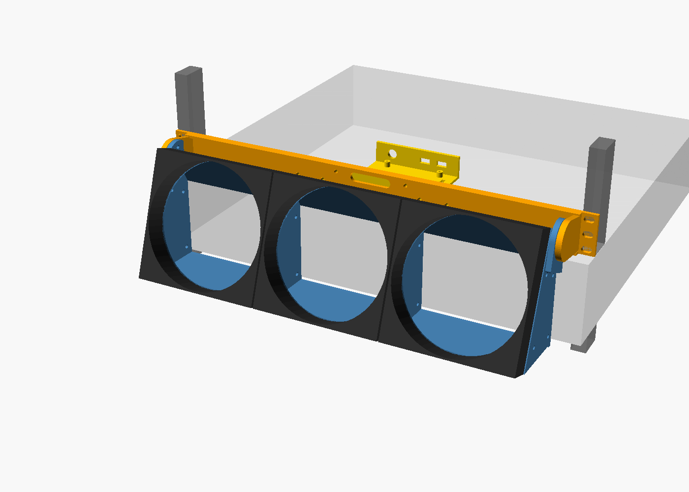
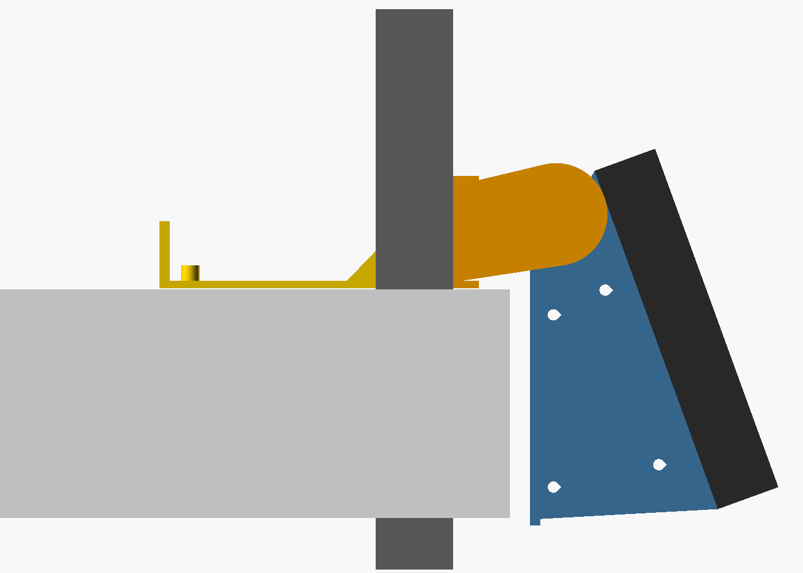
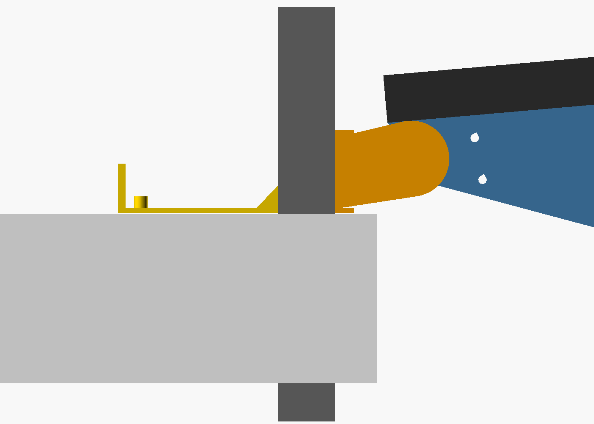

# JBOD fan hanger

**Building one? Start with the [build guide](../../docs/jbod/GUIDE.md)** (parts list, wiring diagram, flashing, assembly), and tick through [CHECKLIST.md](CHECKLIST.md): go/no-go checks,
measurements, test prints, bench test and thermal acceptance, in order.

A 3D-printed 1U rack tray that holds the ESP32 and power, with a hinged
duct carrying three 140 mm fans. The duct hangs in front of a 2U 12-bay
JBOD (built around an HPE D3600) and blows into the drive bays.

| Closed: gravity holds the foam rim on the JBOD | Open: lifted 75° and pinned |
|---|---|
|  |  |

- The **tray** fits the 1U directly above the JBOD and screws to the rack
  ears. The electronics shelf behind it rests on the JBOD's lid.
- The **ducts** hang from a hinge on each end of the tray. Their weight sits
  in front of the hinge, so gravity swings them back until the foam-lined rim
  presses on the drive fronts. That seal makes the air go through the drive
  bays instead of spilling around them.
- **Getting at the drives:** lift the duct row and push an M4 pin through the
  "open" hole on each side. A second hole locks it closed, for moving the rack.
- The **fans** lean 20° with their tops toward the rack, so they blow down and
  in. The duct narrows the 140 mm fan face to the 2U bay opening.

## Before you print, measure your rack

All of these are at the top of `jbod_hanger.scad`. The defaults are guesses
for a D3600, not measurements.

| Parameter | What | Default |
|---|---|---|
| `rim_y` | How far the drive handles/latches stand out from the rack-post face, plus ~5 mm of foam | 30 |
| `bay_z0`, `bay_z1` | Bottom and top of the drive-bay opening, measured from the bottom of the JBOD's 2U | 2, 87 |
| `tilt`, `fan_top_y`, `fan_top_z` | Fan angle and position | 20°, 55, 135 |
| `open_angle` | How far it swings up. When open, the fan tops reach about 27 mm into the U above, 20 mm in front of the posts. Lower this if gear above has a deep bezel. | 75 |

Print `fit_gauge` first: a flat, full-size side profile you hold against the
rack to check the measurements. Then print `pin_test` (the hinge arm and a duct
ear) to check the bolt and pin fit before the big parts. If a measurement can't
work (rim too close, duct row too wide, part bigger than `bed`), the model stops
with an error naming it.

## Parts

Export everything with `./export.sh` (STLs land in `stl/`, already
oriented for printing). Re-render the preview images with `./render.sh`.

| Part | Qty | Size (mm) | Print orientation |
|---|---|---|---|
| `fit_gauge`, `pin_test` | 1 each | 126 × 150 × 3, 59 × 151 × 6 | Flat |
| `duct_left`, `duct_center`, `duct_right` | 1 each | 148 × 141 × 73 | Rim face down, no supports |
| `tray_left`, `tray_right` (with ears and hinge arms) | 1 each | 170 × 49 × 60 | Back face down, no supports |
| `tray_center` | 1 | 142 × 44 × 10 | Back face down |
| `shelf` | 1 | 100 × 114 × 42 | Floor down |
| `splice` | 2 | 50 × 32 × 4 | Flat |

All parts fit a 180 × 180 mm bed. Material: **PETG or ASA, not PLA.** Racks
run warm, and PLA creeps under a constant load like the hinge. Settings:
0.2 mm layers, 4 walls, 30 % gyroid infill. The fan-plate corners overhang
about 70° for a few mm; they bridge fine without supports on most printers.

## Hardware

| Item | Qty |
|---|---|
| 140 mm 4-pin PWM fans with high static pressure (Noctua NF-A14 industrialPPC-2000 PWM, Arctic P14 PWM, …) | 3 |
| 140 mm wire finger guards | 3 |
| M4 × 35 bolts + nuts (fan + guard through the face plate) | 12 |
| M4 × 12 bolts + nuts + washers (duct-to-duct: 4 per seam; splices; shelf) | 16 |
| M6 × 25 bolts + nyloc nuts + 4 washers (hinge) | 2 |
| M4 × 20 bolts + wing nuts, or 4 mm pins (lock pins) | 2 |
| M6 rack screws + cage nuts | 6 |
| Foam weatherstrip, 10 × 5 mm | ~1.2 m |
| Electronics: see [esp32/README.md](../../esp32/README.md) (ESP32 DevKit, 7 × 9 cm perfboard, 12→5 V buck, panel DC jack, 12 V 2 A brick, 3 × 10k, optional DS18B20 + 4.7k) | |

## Assembly

1. Bolt the three ducts together through the side-wall holes (M4 × 12, 4 per seam).
2. Mount each fan on the outside of its face plate, blowing **into** the duct
   (the label side usually faces the duct). Put the finger guard on top, held
   by the same M4 × 35 bolts.
3. Stick foam along the top and bottom rim flanges.
4. Join the three tray pieces with the two splices on the back. Bolt the shelf
   to the centre piece, then screw the tray into the 1U above the JBOD.
5. Hang the duct row: one M6 bolt through each tray arm and duct ear, with a
   washer on each side and a nyloc nut snug enough to move freely without play.
6. Run the fan cables through the slot in the centre faceplate to the
   perfboard, leaving a loop long enough for the duct to swing up.
7. Optional: tape the DS18B20 probe in the JBOD's rear exhaust.

## Before you pull the D3600's own fans

- **Check what the enclosure does without them.** I don't know how the
  D3600's I/O modules react to missing fan modules. Enclosures like this can
  raise an alarm, run the remaining fans flat out, or power the drives down
  after a timeout. Pull one module first, watch for a few minutes, and only
  carry on if it just logs a warning.
- **Check the PSUs.** If the PSUs have their own fans, leave them in. If the
  enclosure fans also cool the PSUs or the I/O modules (SAS expanders), those
  parts now depend on air pushed through the drive bays. Run the new fans at
  100 % for the first test.
- **Test under the worst case.** Run a parity check (every drive busy) with
  the new fans at 100 %, then on the curve, and watch the hottest drive on
  the dashboard. Under about 45 °C (113 °F) is fine; much past 50 °C (122 °F), get more airflow
  (higher-pressure fans, a better seal) before you trust it.
- The empty fan bays at the back become exhaust holes. That's fine with fans
  pushing in from the front; don't block them.
